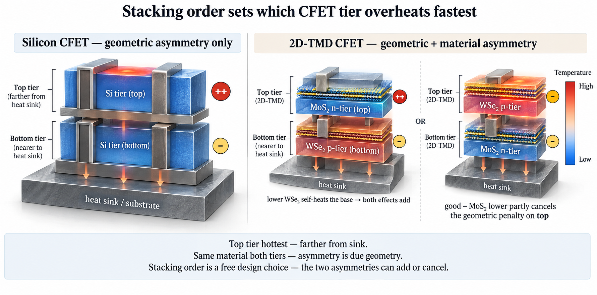
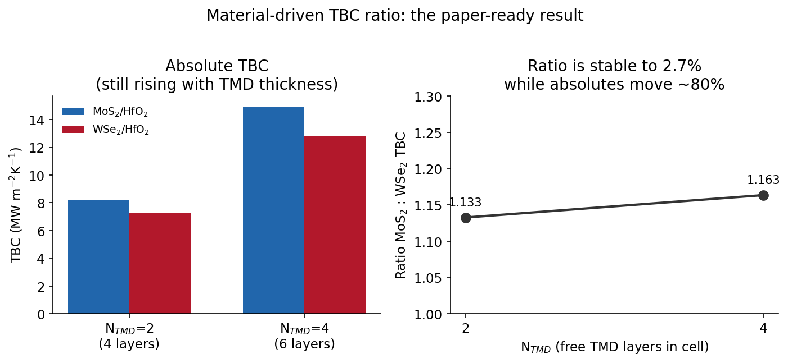
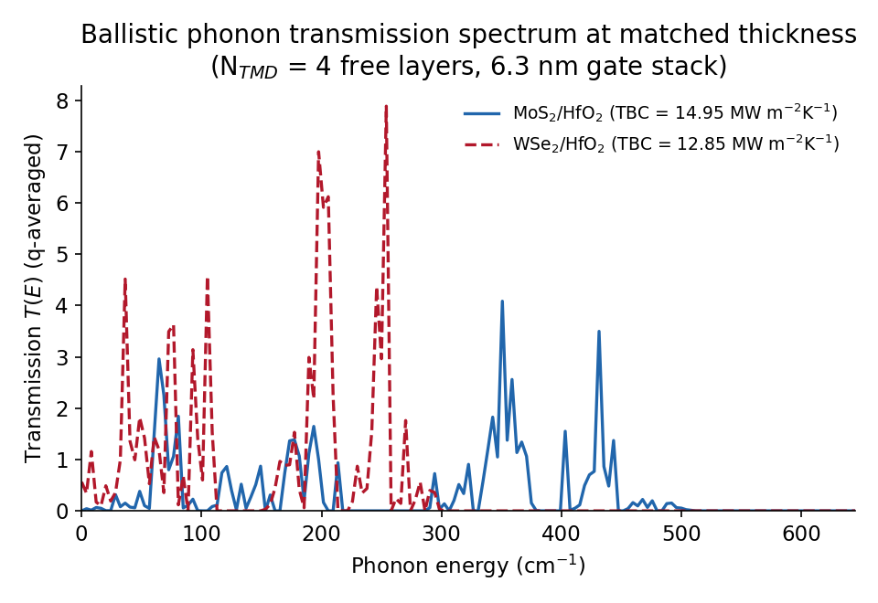
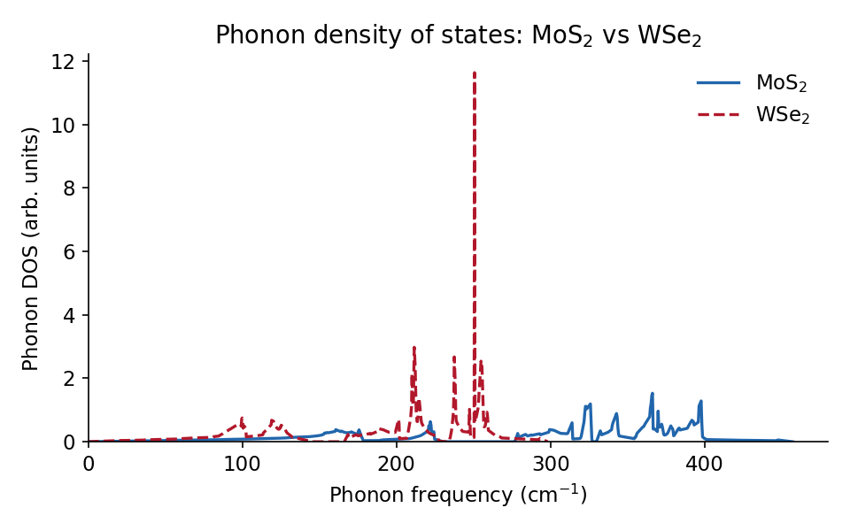

# Material-Driven Thermal Asymmetry in 2D-TMD CFETs

Tushar Dudeja, VIT (in progress)

## Abstract

Complementary field-effect transistors (CFETs), which stack an n-type device directly
on top of a p-type device, are a leading device architecture for sub-2 nm logic
scaling. When implemented in two-dimensional transition-metal dichalcogenides
(2D-TMDs), CFETs require heterogeneous channel materials, MoS2 for the n-tier and WSe2
for the p-tier, because no single monolayer semiconductor provides good transport for
both carrier types. This heterogeneity introduces a thermal asymmetry that has not been
characterized: MoS2 and WSe2 differ in bulk thermal conductivity by roughly 21x, on top
of the geometric self-heating asymmetry already present in any stacked device. Because
the stacking order is a free design choice, these two asymmetries (geometric and
material) can add or cancel depending on which material sits nearer the heat sink. This
project uses first-principles and machine-learning-potential atomistic simulation in
QuantumATK to compute the interfacial thermal boundary conductance (TBC) of MoS2/HfO2
and WSe2/HfO2 interfaces via ballistic (Landauer) phonon transport, and establishes the
ratio between them as a robust design parameter: TBC(MoS2/HfO2) : TBC(WSe2/HfO2)
approximately 1.13 to 1.16, shown to be stable to within 2.7% across an 80% change in
simulation cell thickness that otherwise moves the absolute values by a comparable
amount. Together with phonon spectra computed across a six-material TMD family and a
validated machine-learning-potential methodology, these results are intended to feed a
multi-tier CFET electro-thermal-aging device model to determine whether channel-material
stacking order can be used as a passive design lever against the reliability bottleneck
in 2D-TMD CFETs.

## The problem

A silicon CFET's top tier runs hotter than its bottom tier for a purely geometric
reason: it sits farther from the heat sink. A 2D-TMD CFET cannot make that
simplification, because it is forced to use two different channel materials whose
thermal conductivities differ sharply. That means a 2D-TMD CFET carries two asymmetry
drivers at once, and because stacking order is a free choice, the two can be made to
add or to cancel. No published study has quantified this: 2D-CFET papers either skip
self-heating entirely, or treat both channel materials with the same bulk thermal
conductivity table and zero interfacial resistance, an assumption this project shows is
wrong.

<p align="center">
  
</p>

## Approach

QuantumATK supplies what a device-level TCAD tool cannot: atomistic phonon properties
and interfacial thermal boundary conductance, computed from first principles and
validated machine-learned interatomic potentials. That feeds a multi-tier CFET
electro-thermal-aging device platform, which supplies the transistor structure and
reliability projection. The combination of atomistic phonon transport, a multi-tier
device platform, and a resulting design rule is the contribution.

| Stage | What | Status |
|---|---|---|
| Literature survey and toolchain validation | What is and is not computable with this stack, checked against the reference manual and vendor examples rather than assumed | Done |
| Phonon spectra, 6-material TMD family | MoS2, WS2, MoSe2, WSe2, MoTe2, WTe2, computed with a force field and cross-checked with DFT | Done |
| Potential and methodology validation | Machine-learned potentials benchmarked for phonon accuracy and van der Waals binding; a hidden failure mode where potentials with correct phonons still gave zero interlayer binding was found and fixed | Done |
| Heterointerface construction | MoS2/HfO2 and WSe2/HfO2 interfaces, atomistically relaxed and verified | Done |
| Interface thermal boundary conductance | Ballistic phonon transmission across each interface, matched-protocol thickness sweep | Done, see results below |
| Device-level implications | Feeding the computed TBC ratio into the multi-tier device platform (Sentaurus, tier temperature maps, aging) | In progress |

## Results

The headline result is the first computed MoS2-vs-WSe2 thermal boundary conductance
ratio at a device-relevant oxide interface, together with a demonstration that it is a
genuine physical ratio rather than a simulation-size artifact.

<p align="center">
  
</p>

- TBC(MoS2/HfO2) = 14.95, TBC(WSe2/HfO2) = 12.85 MW per m2 per K, giving a ratio of
  approximately 1.13 to 1.16.
- The ratio was checked against a thickness-convergence trap: the absolute TBC values
  climb by about 80% between the two simulation cell sizes tested, which would normally
  make the result unpublishable. The ratio between the two materials, however, moves
  only 2.7% across that same 80% swing, meaning the thickness sensitivity is common-mode
  and cancels, and the ratio is the number that survives.
- This was a pre-registered test: the thickness sweep was launched specifically to
  determine whether the ratio would hold, not run after the fact to explain a result.

<p align="center">
  
</p>

The plot above is the physics behind that ratio: the ballistic phonon transmission
spectrum T(E) across each interface, computed from a device configuration with
semi-infinite electrodes rather than a bulk approximation, integrated to give the TBC.
WSe2/HfO2 transmits more strongly at low energy but over a narrower band, consistent
with its softer phonon spectrum (below), the atomistic origin of its lower thermal
conductivity.

<p align="center">
  
</p>

### Methodology results worth noting on their own

- A silent failure mode was identified and fixed: machine-learned interatomic potentials
  that reproduce phonon spectra to under 1% error can still give zero van der Waals
  binding between layers, with no error message and no obvious symptom, producing a
  result that would have been confidently wrong. This was diagnosed by benchmarking five
  candidate potentials against both phonons and interlayer binding energy, then fixed by
  making a dispersion correction (DispersionD3BJ) mandatory. It was independently
  cross-checked against a second, unrelated method (Lennard-Jones cross-terms via the
  Lorentz-Berthelot combining rule), which reproduced a published reference table to
  within 1.2% on 9 of 11 entries, and found two typos in that published table.
- A geometry convention was found the hard way: oxide surface termination changes the
  relaxed van der Waals gap by a factor of about 5 (4.7 A versus 0.81 A for the same
  interface with a different termination), a reusable, previously undocumented finding
  for anyone building TMD/HfO2 heterointerfaces in QuantumATK.
- GPU capability was correctly characterized after an initial wrong conclusion: the
  licensed QuantumATK GPU path genuinely does not exist on the cluster used here, but
  machine-learned potentials (MACE) turned out to reach the GPU directly through
  PyTorch, bypassing the vendor license entirely. This reversed an earlier "CPU only"
  conclusion and unblocked runs that had been assumed infeasible.

## What is not claimed

No anharmonic phonon-Boltzmann-transport solver exists in this toolchain, so diffusive
thermal conductivity (kappa) values are cited from literature, never derived here; the
atomistic contribution here is TBC and phonon spectra, not bulk kappa. The ballistic
Landauer transmission is an upper bound relative to molecular-dynamics TBC estimates, so
only ratios between this project's own interfaces are treated as robust, not absolute
values compared against other methods. The device-level consequence, whether this ratio
actually flips which CFET tier is the reliability bottleneck, is the next phase and has
not yet been computed.

## Repository layout

```
scripts/    the QuantumATK Python driving every result above, plus the figure builder
figures/    the figures in this README, plus figures/_raw_data/ (the extracted data behind them)
```

## Reproducing

The QuantumATK calculations run on a remote GPU cluster reached over SSH through a jump
host. `ssh_run_atq.py` and `sftp_atq.py` handle the connection; copy
`config.example.txt` to `config.txt` (gitignored) with your own host and credentials to
use them.

```bash
python scripts/production/make_figures.py   # rebuilds figures/ from figures/_raw_data/
```

## Target venues

IEEE T-DMR, IEEE TCAD, Microelectronics Reliability, IEEE JXCDC, Journal of Applied
Physics.
